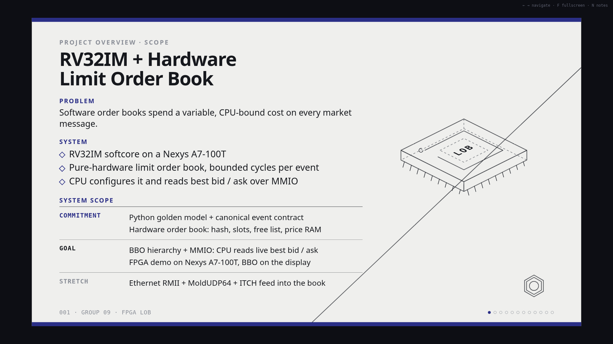
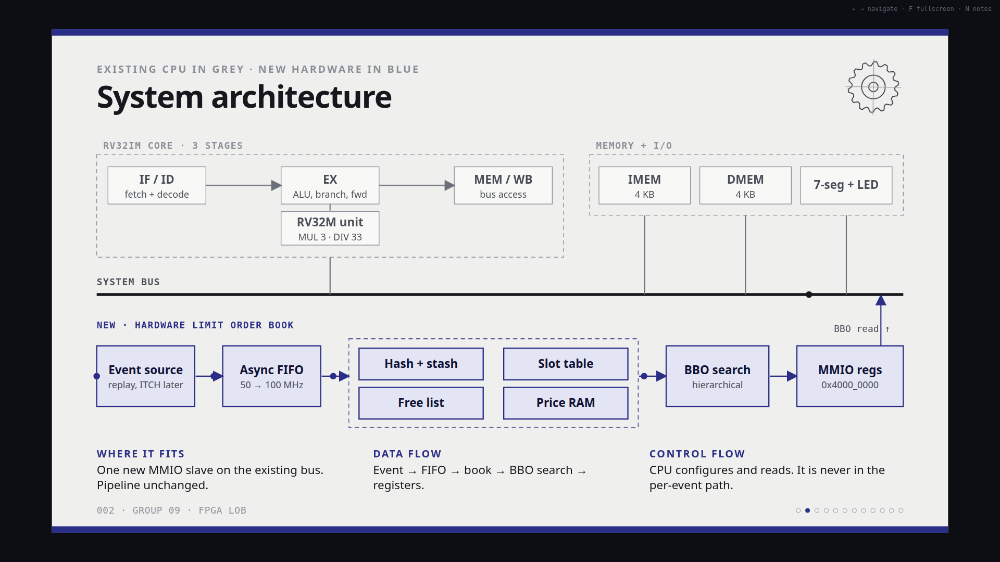
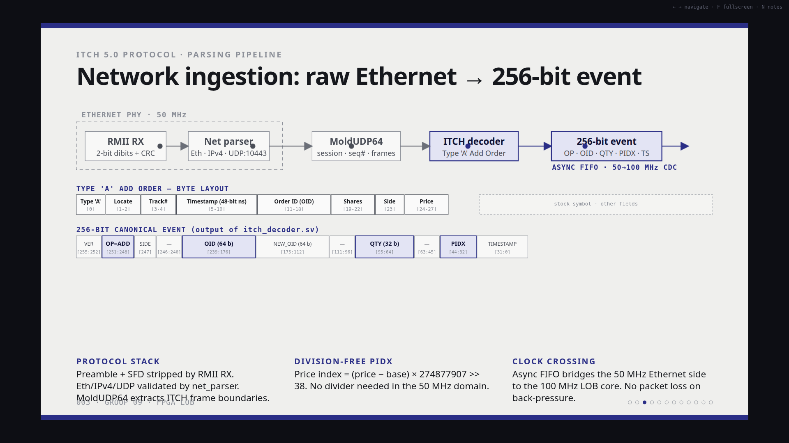
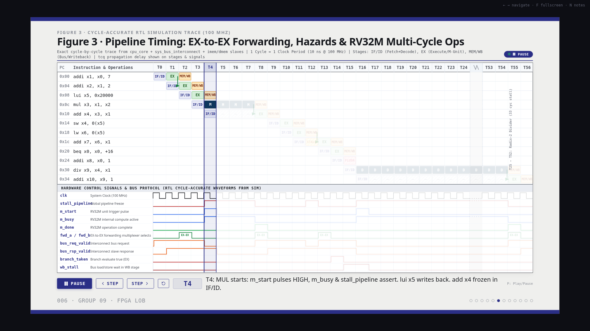

# Hardware-Accelerated Limit Order Book (LOB) Accelerator & RV32IM Coprocessor

<div align="center">

[](https://github.com/Group-09-FPGA/FPGA-Project/actions/workflows/rtl_verification.yml)
[](https://github.com/Group-09-FPGA/FPGA-Project/actions/workflows/software_and_feed.yml)
[](https://github.com/Group-09-FPGA/FPGA-Project/actions/workflows/hardware_audit.yml)
<br>
[](https://www.xilinx.com)
[](docs/architecture.md)
[](docs/itch.md)
[](rtl/)
[](docs/core_synth_timing.rpt)

<p align="center">
  <b>A sub-microsecond, pointer-free Limit Order Book accelerator with an autonomous RV32IM softcore processor on AMD/Xilinx Artix-7 FPGA.</b>
</p>

</div>

---

## 📽️ Project Presentation Highlights

### 1. Project Overview & Scope
The system replaces variable, CPU-bound software matching overhead with a deterministic, bounded-cycle hardware execution pipeline on the Digilent Nexys A7-100T FPGA.



---

### 2. Full System Architecture
Clean separation between the fast-path market data processing engine and the out-of-band RV32IM CPU management plane over a synchronous system bus.



---

### 3. Network Ingestion Pipeline: Raw Ethernet to 256-bit Event
Hardware-accelerated network pipeline stripping RMII preambles, validating IPv4/UDP checksums, parsing MoldUDP64 sequence frames, and unpacking NASDAQ ITCH 5.0 messages into 256-bit canonical hardware events.



---

### 4. Cycle-Accurate Pipeline Timing & Waveforms
Detailed execution trace demonstrating EX-to-EX operand forwarding, branch hazard resolution, system bus wait-states, and RV32M multi-cycle multiplier/divider execution without frontend stalling.



---

## ⚡ Core Technical Features

### 1. Deterministic Hardware Limit Order Book (LOB)
* **Bounded Latencies:**
  * **ADD Order:** 6 cycles (60 ns @ 100 MHz)
  * **EXECUTE Order:** 8–10 cycles (80–100 ns)
  * **CANCEL Order:** 8–10 cycles (80–100 ns)
  * **REPLACE Order:** 12 cycles (120 ns)
* **Pointer-Free Design:** Eliminates linked lists using a static 2,048-entry Slot Table and an $O(1)$ Free List allocation stack.
* **Hierarchical BBO Tracker:** Bitmask priority tree identifying Best Bid and Offer in 1–2 clock cycles (20–30 ns), outperforming software scans by over **270×**.

### 2. RV32IM Softcore Processor
* **Modular 3-Stage Pipeline:** Decoupled Instruction Fetch/Decode (IF/ID), Execute (EX), and Memory/Writeback (MEM/WB).
* **Hardware M-Extension (RV32M):**
  * 3-cycle DSP48E1 pipelined multiplier (`MUL`, `MULH`, `MULHU`, `MULHSU`).
  * 32-cycle Radix-2 non-restoring serial divider with zero-overhead skid buffers (`DIV`, `DIVU`, `REM`, `REMU`).
* **System Bus MMIO Interconnect:** Standard request-response bus supporting atomic 64-bit BBO snapshots, telemetry, and diagnostics.

### 3. Ethernet & Market Data Feed Handler
* **LAN8720A RMII PHY Interface:** 50 MHz clock domain receiver with on-the-fly CRC-32 FCS checking and runt frame dropping.
* **NASDAQ ITCH 5.0 Parser:** Hardware unpacking of Type `'A'` Add Order messages with division-free price-to-index mapping (`Price Index = (Price - Base) × 274877907 >> 38`).
* **Asynchronous CDC FIFO:** Gray-code pointer synchronizers bridging the 50 MHz Ethernet domain to the 100 MHz Core domain.

### 4. Software LOB Reference Model (`software_lob/`)
* **Python Golden Model:** Full architectural software reference simulator implementing NASDAQ ITCH 5.0 decapsulation, MoldUDP64 sequence gap recovery, and price-time priority queues.
* **Verification Suite:** 38 automated unit and end-to-end scenario tests (`software_lob/tests/unit`, `software_lob/tests/scenarios`) continuously verified in CI.
* **Differential Verification:** Acts as the executable functional oracle against which RTL testbenches and canonical event streams are validated.

---

## 🤖 Continuous Integration Pipelines

This repository is protected by **3 automated GitHub Actions CI workflows** ensuring verified code quality, RTL elaboration, and regression-free hardware operation on every commit:

| CI Workflow | Workflow File | Tools & Engines | Verification Scope | Status |
| :--- | :--- | :--- | :--- | :---: |
| **RTL Verification** | [`.github/workflows/rtl_verification.yml`](.github/workflows/rtl_verification.yml) | Verilator 5.x + Icarus Verilog | Full 36-module SystemVerilog linting + 4 functional testbenches (`tb_cpu_core`, `tb_rmii_rx`, `tb_lob_event_decoder`, `tb_lob_free_list`) | [](.github/workflows/rtl_verification.yml) |
| **Software & Feed Tests** | [`.github/workflows/software_and_feed.yml`](.github/workflows/software_and_feed.yml) | Python 3.12 (`unittest`) | MoldUDP64/ITCH 5.0 packet serializers, 256-bit canonical event packing, and 32 golden test vectors | [](.github/workflows/software_and_feed.yml) |
| **Hardware Audit** | [`.github/workflows/hardware_audit.yml`](.github/workflows/hardware_audit.yml) | Xilinx Vivado Report Parser | Audits post-route timing (+5.959 ns setup slack MET @ 100 MHz) and packages release bitstream artifacts | [](.github/workflows/hardware_audit.yml) |

---

## 🚀 Running Simulations Locally

### 1. Hardware Simulation Suite
To run the automated hardware unit test suite locally using Icarus Verilog:
```bash
./sim/run_ci_tests.sh
```

### 2. Full RTL Static Linting
To run static analysis across all SystemVerilog modules using Verilator:
```bash
verilator --lint-only -sv -DSIMULATION \
  -Wno-WIDTHEXPAND -Wno-WIDTHTRUNC -Wno-TIMESCALEMOD -Wno-PINMISSING \
  -Wno-CASEINCOMPLETE -Wno-MULTIDRIVEN -Wno-UNUSEDSIGNAL \
  -Irtl/cpu/core -Irtl/lob -Irtl/common -Irtl/clocking -Irtl/ethernet \
  -Irtl/network -Irtl/itch -Irtl/display -Irtl/telemetry -Irtl/bus -Irtl/top \
  rtl/lob/lob_pkg.sv rtl/top/top_system.sv
```

### 3. Software & Market Feed Tests
To run the Python verification suite:
```bash
python3 -m unittest discover -s tests -v
```

---

## 📊 FPGA Resource Utilization & Timing Summary

Target Device: **AMD/Xilinx Artix-7 `XC7A100T-1CSG324C`** | Vivado 2026.1

| Resource | Used | Available | Utilization % |
| :--- | :---: | :---: | :---: |
| **LUT (Logic)** | 20,604 | 63,400 | **32.5%** |
| **Registers (FF)** | 35,347 | 126,800 | **27.9%** |
| **Block RAM (36Kb)** | 37.0 | 135 | **27.4%** |
| **DSP48E1 Slices** | 18 | 240 | **7.5%** |
| **Timing Slack (WNS)** | **+5.959 ns** | — | **MET @ 100 MHz** |

---

## 👥 Team
* **Group:** Group 09 (CS2202L Hardware Lab)
* **Platform:** Digilent Nexys A7-100T FPGA